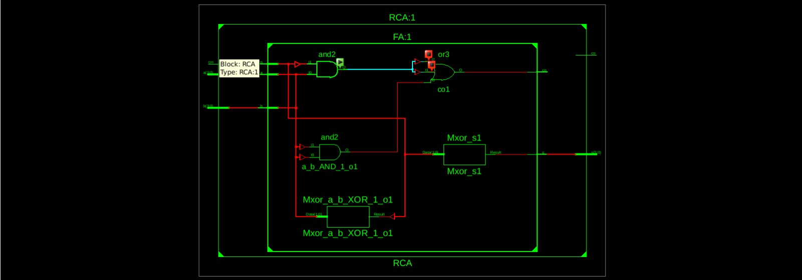
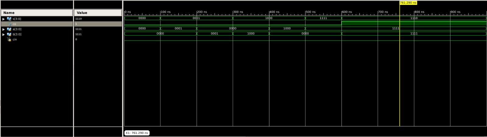
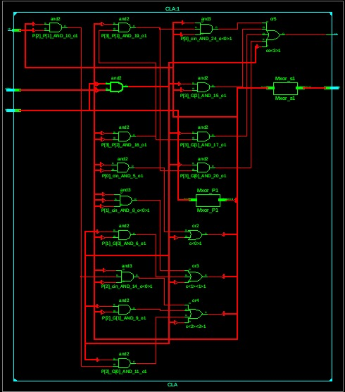
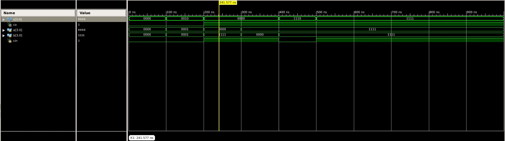
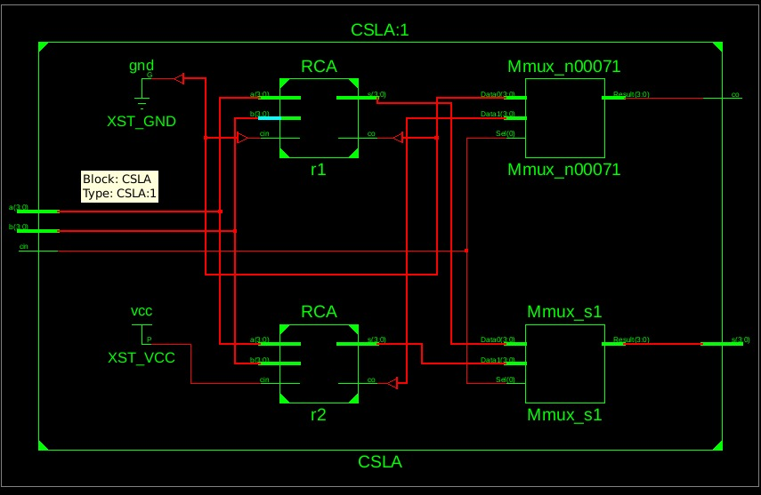
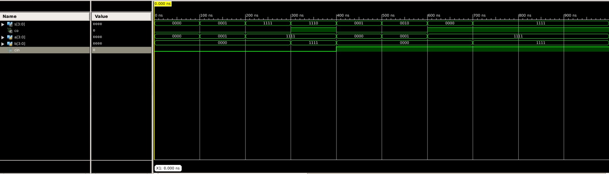

# 4-bit Adders in Verilog (RCA, CLA, CSLA)

This repository demonstrates three common **4-bit binary adder architectures** in Verilog HDL: Ripple Carry Adder (RCA), Carry Look-Ahead Adder (CLA), and Carry Select Adder (CSLA). It is designed as a beginner-friendly learning project for understanding how digital circuits add binary numbers, how carry signals move through hardware, and how different adder designs trade off between speed and hardware complexity.

## What is an adder?

An **adder** is a digital circuit that adds binary numbers.

In this project, each adder takes:
- `a` (4-bit input): first number
- `b` (4-bit input): second number
- `cin` (1-bit input): carry-in from a previous stage (or external source)

And produces:
- `s` (4-bit output): sum bits
- `co` (1-bit output): carry-out (overflow to next higher bit)

Think of `cin` and `co` as the "extra carry" entering and leaving the 4-bit block.

## Adder comparison (quick view)

| Adder | Basic idea | Speed | Hardware / Resource tradeoff | Source file |
|---|---|---|---|---|
| RCA | Chains full adders; carry ripples bit-by-bit | Slowest of the three for larger word sizes | Least hardware, simplest wiring | `4bit Ripple Carry Adder(RCA) .v` |
| CLA | Pre-computes carry terms using generate/propagate logic | Faster carry computation | More combinational logic than RCA | `4bit Carry LookAhead Adder(CLA).v` |
| CSLA | Computes results for carry=0 and carry=1, then selects | Usually fast (selection avoids long carry wait) | Higher area due to duplicated paths + muxing | `4bit Carry Select Adder(CSLA).v` |

## Repository structure

```text
/home/runner/work/Adders/Adders
├── 4bit Ripple Carry Adder(RCA) .v
├── 4bit Carry LookAhead Adder(CLA).v
├── 4bit Carry Select Adder(CSLA).v
├── RCA.tb
├── CLA_tb
├── CSLA_tb
├── RCA_rtl.jpeg
├── RCA_waveform.jpeg
├── CLA-rtl.jpeg
├── CLA_waveform.jpeg
├── csla_rtl.jpeg
├── csla_waveform.jpeg
└── README.md
```

## Design overview (beginner intuition + Verilog concepts)

### 1) Ripple Carry Adder (RCA)
- **Intuition:** Each bit waits for the previous bit's carry, like passing a message in a line.
- **In code:** A `FA` (full adder) module is instantiated four times.
- **Key Verilog concept:** **Module instantiation** and connecting intermediate wires (`c[2:0]`).

### 2) Carry Look-Ahead Adder (CLA)
- **Intuition:** Instead of waiting for carry to ripple, it predicts carries using logic equations.
- **In code:** Uses **generate (`G = a & b`)** and **propagate (`P = a ^ b`)** signals to compute carries quickly.
- **Key Verilog concept:** **Continuous assignments** (`assign`) for combinational equations.

### 3) Carry Select Adder (CSLA)
- **Intuition:** Calculates two possible results in parallel (`cin=0` and `cin=1`) and picks the correct one.
- **In code:** Instantiates two RCA paths and selects outputs with conditional assignments.
- **Key Verilog concept:** **Parallel computation** + **ternary operator selection** (`cin ? ... : ...`).

## Simulation and verification

This repository includes **stimulus-based testbenches** (`RCA.tb`, `CLA_tb`, `CSLA_tb`) that apply input patterns over time. They are useful for waveform observation and functional understanding.

You can run simulations with **Icarus Verilog (`iverilog`)** and view waveforms with **GTKWave (`gtkwave`)**. Since some filenames include spaces and parentheses, use shell quoting.

> Commands may need small adjustments depending on your simulator, OS shell, and whether you add waveform dump statements.

### Example commands (Icarus Verilog)

```bash
# RCA
iverilog -o rca_sim '4bit Ripple Carry Adder(RCA) .v' RCA.tb
vvp rca_sim

# CLA
iverilog -o cla_sim '4bit Carry LookAhead Adder(CLA).v' CLA_tb
vvp cla_sim

# CSLA
iverilog -o csla_sim '4bit Carry Select Adder(CSLA).v' CSLA_tb
vvp csla_sim
```

If your testbench writes a VCD file (for example `dump.vcd`), open it with:

```bash
gtkwave dump.vcd
```

## Example expected behavior

Suppose:
- `a = 4'b1111` (15)
- `b = 4'b0001` (1)
- `cin = 1'b0`

Then total is `16` (`10000` in binary), so:
- `s = 4'b0000` (lower 4 bits)
- `co = 1'b1` (extra carry-out bit)

If `cin = 1'b1`, the adder includes that extra 1 in the total.

## RTL and waveform images

### RCA

**RTL**



**Waveform**



### CLA

**RTL**



**Waveform**



### CSLA

**RTL**



**Waveform**



## Learning outcomes

After exploring this repository, you should be able to:
- Explain the role of `a`, `b`, `cin`, `s`, and `co` in binary addition.
- Describe how RCA, CLA, and CSLA differ in carry handling.
- Read basic Verilog module structure and combinational assignments.
- Simulate small HDL designs and interpret waveform results.

## Future improvements

- Add a single top-level test strategy that runs multiple test vectors for all adders.
- Add parameterized versions (e.g., N-bit adders) for scalability.
- Include synthesis reports for area/timing comparison as a separate documented experiment.
